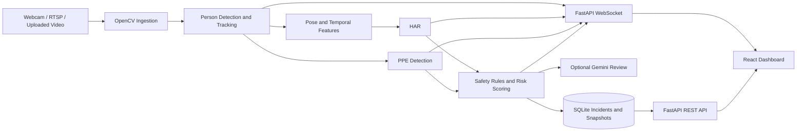

# AI-Powered Industrial Safety Monitoring System


An edge-oriented computer-vision application for monitoring workplace safety in industrial and construction environments. It processes webcam, RTSP, and uploaded video sources; tracks people; evaluates PPE and safety rules; and streams annotated frames and incident telemetry to a web dashboard.

## Frontend Live Link

> **Frontend Live Link:** [_AI_Powered_Industrial_Safety_Monitoring_System_](https://ai-powered-industrial-safety-monito.vercel.app/)

The frontend is deployable to Vercel. The FastAPI backend, inference models, camera source, database, and uploaded-video storage must run on a separate host with the required hardware and persistent storage.

## Table of Contents

- [Overview](#overview)
- [Features](#features)
- [System Architecture](#system-architecture)
- [Technology Stack](#technology-stack)
- [Requirements](#requirements)
- [Local Setup](#local-setup)
- [Run the Application](#run-the-application)
- [Use the Application](#use-the-application)
- [Configuration and Model Assets](#configuration-and-model-assets)
- [Testing and Profiling](#testing-and-profiling)
- [Deploy the Frontend to Vercel](#deploy-the-frontend-to-vercel)
- [Repository Layout](#repository-layout)
- [Project Status](#project-status)
- [Author](#author)

## Overview

The application combines a Python inference pipeline with a React dashboard. The backend ingests a video stream, runs person detection and tracking, estimates pose and activity, applies PPE and safety rules, calculates risk, stores incidents, and publishes frames and telemetry. The browser provides Live Mode for backend inference and Demo Mode for an illustrative UI walkthrough.

This is a development and decision-support project. Treat model output as an aid for review, not as a replacement for site procedures or human supervision.

## Features

- **Multiple sources:** backend webcam, RTSP, and video file inputs.
- **Person tracking:** detector boxes and persistent track IDs.
- **Pose and activity:** pose-derived temporal features and HAR predictions when a trained checkpoint is available.
- **Safety evaluation:** fall, PPE, restricted-zone, and climbing rules with per-person and scene risk scores.
- **Live dashboard:** WebSocket video frames and telemetry, with controls for boxes, IDs/HAR, PPE badges, and hazard zones.
- **Video upload and history:** upload a video from Live Monitoring, process it, and keep it under `data/videos/` for later selection.
- **Incident evidence:** incident keyframes are saved under `data/snapshots/`; incidents created during an uploaded-video run can also play the source video in Event Details.
- **Incident history:** REST endpoints and SQLite persistence for events, resolution status, and summary metrics.
- **Optional VLM review:** Gemini integration is configurable; it is disabled by default.
- **Demo Mode:** simulated telemetry and scene rendering for UI demonstrations without running the inference pipeline.

## System Architecture



## Technology Stack

| Area | Main technologies |
|---|---|
| Backend API | Python, FastAPI, SQLAlchemy, SQLite |
| Video and vision | OpenCV, Ultralytics, MediaPipe |
| Activity recognition | PyTorch temporal transformer |
| Frontend | React, TypeScript, Vite, Tailwind CSS |
| Live transport | WebSocket |
| Charts | Recharts |
| Optional scene review | Gemini API |

## Requirements

- Python 3.11 or newer and Node.js/npm.
- A webcam or accessible video/RTSP source for Live Mode.
- Model assets for the inference components you want to use. Check the configured paths below; trained HAR and PPE checkpoints are not included by default.
- For GPU inference, install a PyTorch build compatible with the machine’s CUDA driver. CPU inference may work more slowly.

## Local Setup

### 1. Clone and install the backend

```bash
git clone https://github.com/atharv-0705/AI-Powered-Industrial-Safety-Monitoring-System.git
cd AI-Powered-Industrial-Safety-Monitoring-System

python -m venv .venv
```

Activate the environment:

```powershell
# Windows PowerShell
.venv\Scripts\Activate.ps1
```

```bash
# macOS / Linux
source .venv/bin/activate
```

Install dependencies and create the local environment file:

```bash
python -m pip install --upgrade pip
pip install -r requirements.txt
```

Copy `.env.example` to `.env`, then adjust the source and CORS settings if needed. For CUDA, replace the generic PyTorch package with the build recommended by the [official PyTorch install selector](https://pytorch.org/get-started/locally/).

### 2. Install the frontend

In another terminal:

```bash
cd frontend
npm install
```

For local development, the Vite proxy forwards `/api`, `/ws`, `/snapshots`, and `/videos` to `http://localhost:8010`. The optional `frontend/.env.example` documents the API and WebSocket URLs for deployments where the backend is hosted separately.

## Run the Application

Start FastAPI from the repository root:

```bash
uvicorn backend.app.main:app --host 0.0.0.0 --port 8010 --reload
```

Start Vite from the `frontend` directory:

```bash
npm run dev
```

Open [http://localhost:5173](http://localhost:5173). FastAPI documentation is available at [http://localhost:8010/docs](http://localhost:8010/docs), and the health endpoint is [http://localhost:8010/api/health](http://localhost:8010/api/health).

## Use the Application

### Demo Mode

Choose **Demo Mode** in the top bar to view the simulated scene and telemetry. This mode is useful for presenting the dashboard without camera hardware or model inference. Simulated detections are illustrative; they are not predictions from the safety models.

### Process an uploaded video

1. Start both the backend and frontend, then choose **Live Mode**.
2. Open **Live Monitoring** and select a video under **Custom Video Source**. MP4 is recommended; the backend accepts MP4, MOV, AVI, MKV, WebM, MPEG, and MPG files up to 500 MB.
3. The backend stores the upload in `data/videos/` and starts processing it. Uploaded videos appear in the video history for later selection.
4. Enable the desired **Boxes**, **IDs & HAR**, **PPE Badges**, and **Hazard Zones** overlays.
5. Review generated incidents under **Events & Incidents**. If an incident was created during this uploaded-video run, Event Details can play the full source video and show the saved keyframe snapshot.

### Process a webcam

1. Connect the webcam to the computer running FastAPI. The default OpenCV source is device `0`; set `VIDEO_SOURCE=0` in `.env` or choose **Default Webcam 0** in Live Monitoring.
2. Select **Live Mode** and click **Start Processing**.
3. Enable the overlays you want to inspect. Webcam HAR is configured for `walking`, `standing`, and `sitting`. Recorded-video HAR supports those classes plus `running` and `climbing`.

The browser displays the backend stream; it does not grant the backend access to the browser’s webcam. If FastAPI runs on a different computer, that host needs its own camera or access to an RTSP stream. HAR needs the trained checkpoint; detector and PPE performance likewise depends on the configured model assets.

## Configuration and Model Assets

Backend configuration is read from `.env` and `backend/app/core/config.py`.

| Setting | Default | Purpose |
|---|---|---|
| `VIDEO_SOURCE` | `0` | Webcam index, video path, or configured stream source |
| `PROCESSING_FPS` | `12` | Target pipeline processing rate |
| `DETECTOR_MODEL` | `yolo11n.pt` | Person detector model path/name |
| `HAR_CHECKPOINT_PATH` | `models/har_temporal_transformer.pt` | Trained activity-recognition checkpoint |
| `PPE_MODEL_PATH` | `models/ppe_yolo11n.pt` | PPE model checkpoint |
| `GEMINI_API_KEY` | empty | Optional Gemini API key; keep it only in the backend environment |
| `VLM_ENABLED` | `false` | Enable optional VLM incident review |
| `DATABASE_URL` | `sqlite:///./data/safety_monitor.db` | Incident/configuration database |
| `CORS_ORIGINS` | local Vite origins | Comma-separated frontend origin allowlist |

Keep `.env` and API keys out of source control. The repository ignores local databases, uploaded videos, datasets, and model checkpoint files. Configure persistent storage on the backend host if uploaded videos and incidents must survive redeployments.

## Testing and Profiling

Run the Week 12 backend regression tests from the repository root:

```bash
pytest backend/tests -q
```

With FastAPI running and a usable camera or video source, profile end-to-end pipeline throughput:

```bash
python backend/scripts/profile_pipeline.py --seconds 60
python backend/scripts/profile_pipeline.py --source data/videos/sample.mp4 --seconds 120
```

The profiler reports frame throughput and backend FPS. For a hardware soak test, run the pipeline for at least 30 minutes and monitor RAM/VRAM, dropped frames, reconnects, database growth, and recovery after source/model errors. Compare profiler results using the same source, model assets, resolution, and hardware.

## Deploy the Frontend to Vercel

The Vercel project should use `frontend` as its **Root Directory**. Use the Vite preset, `npm run build` as the build command, and `dist` as the output directory. The checked-in `frontend/vercel.json` enables SPA deep links.

Deploy FastAPI separately on a host that supports the required inference workload and persistent video/database storage. In Vercel’s project environment variables, set:

```text
VITE_API_BASE_URL=https://your-backend.example.com
VITE_WS_URL=wss://your-backend.example.com/ws/stream
```

Set the backend’s `CORS_ORIGINS` to include the Vercel domain. `VITE_` values are public browser configuration; do not put backend secrets there. See Vercel’s [Vite deployment guide](https://vercel.com/docs/frameworks/frontend/vite) and [environment variable documentation](https://vercel.com/docs/environment-variables) for setup details.

## Repository Layout

```text
backend/
  app/                  FastAPI routes, database, services, and pipeline runner
  pipeline/             Detection, pose, HAR, PPE, and safety/risk logic
  scripts/              Training, diagnostics, and profiling scripts
  tests/                Week 12 regression tests
frontend/
  src/                  React pages, components, API, and WebSocket client
  vercel.json           SPA routing configuration for Vercel
configs/                Runtime configuration
data/                   Local database, snapshots, and uploaded videos
models/                 Model assets (some are generated or supplied locally)
notebooks/              HAR and PPE training notebooks
DECISIONS.md             Architecture decisions and project risk register
```

## Project Status

Weeks 1–11 cover the inference pipeline, safety logic, API/database integration, and frontend dashboard. Week 12 adds regression coverage, a throughput profiler, deployment guidance, and demo hardening. A long-duration hardware soak test remains a manual validation task.

## Author

**Atharv Gupta** · [GitHub](https://github.com/atharv-0705)
